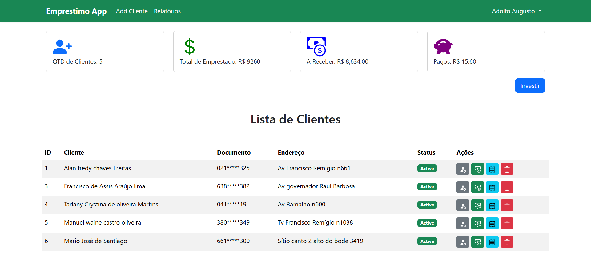
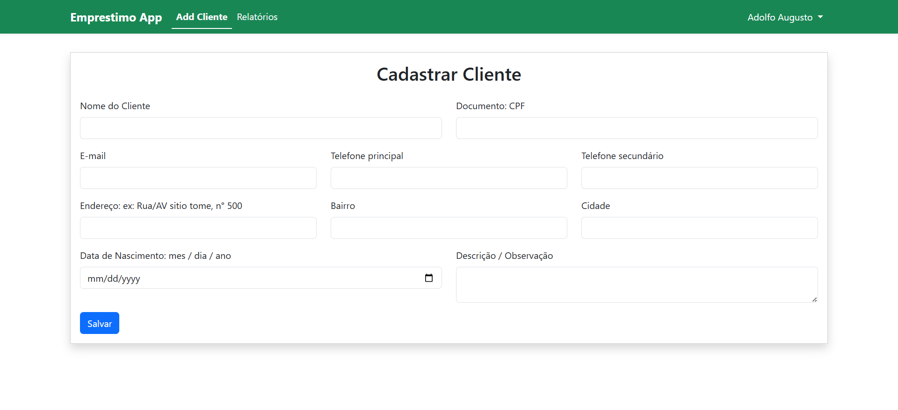
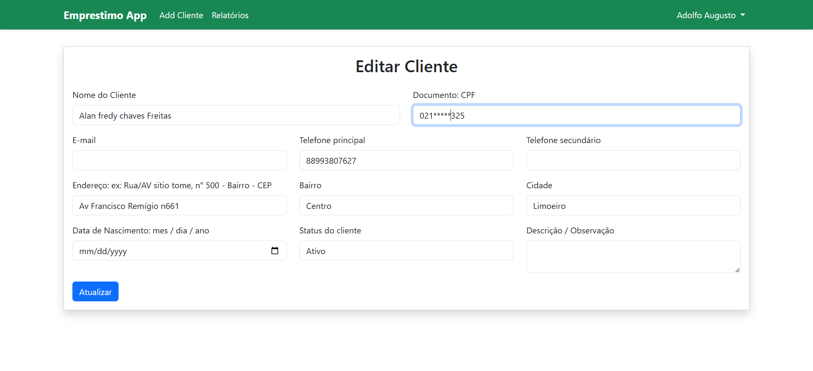
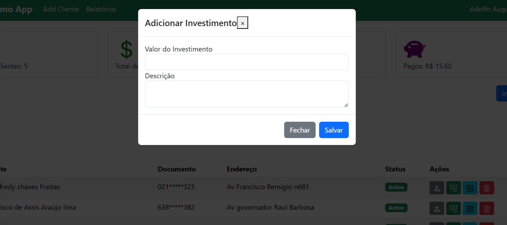
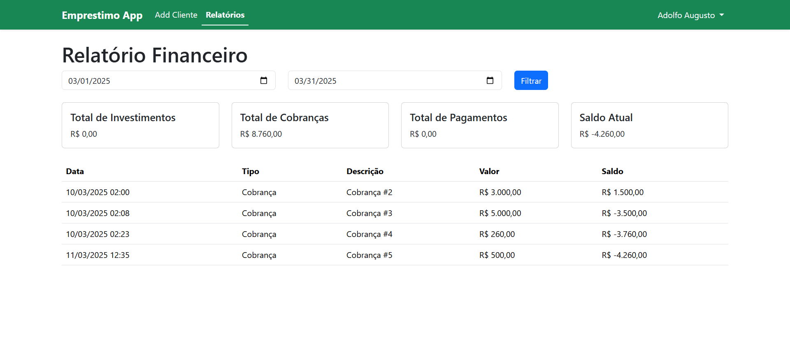

<p align="center"><a href="https://laravel.com" target="_blank"></a></p>

<p align="center">
<a href="https://github.com/laravel/framework/actions"></a>
<a href="https://packagist.org/packages/laravel/framework"></a>
<a href="https://packagist.org/packages/laravel/framework"></a>
<a href="https://packagist.org/packages/laravel/framework"></a>
</p>

### referências

- **[Bootstrap](https://getbootstrap.com/docs/5.3/getting-started/introduction/)**
- **[IconsBootstrap](https://icons.getbootstrap.com/)**

## Starter

[Laravel documentation](https://laravel.com/docs/contributions).

### passo 1
``` php artisan migrate ```
### passo 2
``` php artisan db:seed --class=AdminUserSeeder ```

## Gestão de Clientes e Empréstimos

### Regras de Exclusão e Ocultação Inteligente
- **Integridade Contábil:** Clientes que possuem histórico financeiro (cobranças geradas, parcelas e transações) **não podem ser excluídos fisicamente do banco de dados**, garantindo que relatórios contábeis, cálculo de saldos e histórico de caixa permaneçam 100% íntegros.
- **Ocultação Automática de Quitados:** Clientes que finalizaram/quitaram todos os seus empréstimos são automaticamente ocultados da visualização padrão da "Lista de Clientes" ativa na página inicial para não poluir a operação diária.
- **Filtros da Tabela:** A tabela na Home possui abas de filtro rápido:
  - *Empréstimos Ativos:* Clientes com cobranças em andamento e novos cadastros.
  - *Quitados (Ocultos):* Clientes que já finalizaram todos os débitos.
  - *Todos:* Visão completa da carteira.
- **Busca em Tempo Real:** Campo de busca instantânea na tabela filtrando por nome, documento (CPF) ou endereço.
- **Busca Rápida para Novo Empréstimo:** Modal de busca dedicado ("Abrir Novo Empréstimo") acessível pelo botão no topo da página ou na seção da tabela. Permite pesquisar qualquer cliente da carteira (inclusive os que estão quitados/ocultos) por nome ou CPF para iniciar uma nova cobrança imediatamente via `charges.create`.

## License

The Laravel framework is open-sourced software licensed under the [MIT license](https://opensource.org/licenses/MIT).





